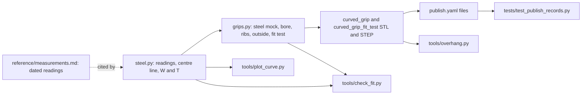

# Task: Curved grip for the Commercial Electric wire stripper

* Task ID: commercial-electric-wire-stripper-curved-grip
* Complexity: Level 3
* Type: feature (new model)

A slide-on TPU 95A grip for the bare curved steel handle. The inside follows the measured curve and taper from A (the tip) to B (83.15 mm from A). It holds by longitudinal crush ribs, whose valleys take glue. The outside is a steel-offset rounded rectangle that the straight grip will share later. The grip prints open end down without supports. It ships as STL and STEP from a CadQuery source in `models/commercial-electric-wire-stripper-grips/`, together with a short fit test of the open end.

All paths below are relative to `models/commercial-electric-wire-stripper-grips/` (written `M/`) unless they start at the repository root.

## Pinned Info

### Data flow

The measured steel is the one source of truth. The grip and its checks are both built from it, and the checks also compare it against the raw readings. This shows which change ripples where.

## Component Analysis

### Affected Components

- `M/steel.py` (new): the measured bare steel, in pure Python. It holds the readings with their dates and cites `reference/measurements.md`. It fits a quartic centre line through the traced centre points; the proof of concept's worst residual was 0.08 mm. W(s) and T(s) are piecewise linear through S1 to S3, extended linearly past the end stations. A is placed so the chord from A to B is the measured 83.15. It exposes a `Handle` description: length A→B, plus point, tangent, W and T as functions of s. The straight handle's data goes here later.
- `M/grips.py` (new): the CadQuery source. Every design dimension is a named parameter citing the creative decisions. From a `Handle` it builds:
  - the mock steel
  - the bore
  - the ribs
  - the outside, with its flare and dome
  - the grip (outside minus bore, plus ribs)
  - the fit test (the grip's first `FIT_LEN` mm)

  It also turns parts to print orientation. Geometry limits are script assertions. Running it writes the outputs and prints the main sizes.
- `M/tools/check_fit.py` (new): pass/fail suite in the h7/h11 style (lettered sections, PASS/FAIL lines, exits 1 on failure).
- `M/tools/overhang.py` (new): copied from h11.
- `M/tools/plot_curve.py` (existing): imports `steel.py`. `M/tools/reduce_curve.py` (existing) is deleted: its data moves to `steel.py`, and its cross-checks become check_fit section A.
- `M/publish.yaml`: `files`, the description and the manufacturing text. License, category and tags stay blank until the operator publishes.
- `M/README.md` (new), `M/memory-bank/systemPatterns.md`, `M/memory-bank/techContext.md`, `M/reference/measurements.md`: docs.

### Cross-Module Dependencies

- `steel.py` → `grips.py`: centre line, W(s), T(s), and the length A→B. The mock steel and the bore come from the same functions.
- `steel.py` → `tools/check_fit.py`: the raw readings are compared with the mock (section A), independently of the grip.
- `grips.py` → `tools/check_fit.py`: the parts are built in use position. The sections cut the grip and the mock steel with the same plane square to the centre line.
- `grips.py` outputs → `publish.yaml` `files` → `tests/test_publish_records.py`.
- `steel.py` → `tools/plot_curve.py`.

### Boundary Changes

- `publish.yaml` `files` becomes non-empty: the public listing contract from the first release on.
- No catalog tooling changes. The model was registered in the setup commit `f834ba2`.

### Invariants & Constraints

- The bore must contain the mock steel from A to B. Grip material may enter the steel's outline only at rib tips, and only by `RIB_BITE_W` in W or `RIB_BITE_T` in T (±0.02).
- Every steel corner must clear the bore by at least 0.15 mm.
- The open end must sit at B, square to the steel's tangent there. The bore's closed end must clear A by at least `END_CLEAR`.
- The wall from the steel face to the outside, on the convex side at B including the flare, must be at most 5.0 mm.
- Print orientation is designed in. The open end must lie flat on z = 0. No downward face may be flatter than 45 degrees above z = 0.2. The bore's closed end is a roof whose faces are at least 45 degrees in print orientation, computed from the tip's lean.
- The fit test must be the grip's first `FIT_LEN` mm exactly, so that it calibrates the real grip.
- One home per number: readings in `steel.py`, design values in `grips.py`. `measurements.md` stays the dated record.
- Exported STLs must be watertight, and the catalog tests must stay green.
- Non-goals: the straight grip, sculpted outsides, snap nubs, and copying the old grip.

## Open Questions

- [x] **Bore fit and glue key.** → Resolved: longitudinal crush ribs, two per face, 1.5 from the corners, on a 0.3 clearance bore. The bore's corners are tight enough to clear a sharp steel corner. Bites start at 0.3 in W and 0.15 in T. The fit test tunes them. (see `memory-bank/active/creative/creative-bore-fit-and-glue-key.md`)
- [x] **Outside shape.** → Resolved: steel-offset rounded rectangle. Walls are measured from the steel: 3.8 in the plane of the handles, 2.5 across it, with corner radius 5. It flares 1.0 over the last 5 mm, so the convex wall at B is 4.8. The closed end is a lofted dome, with a cap of at least 3 over the bore's roof. (see `memory-bank/active/creative/creative-outside-shape.md`)

## Test Plan (TDD)

### Behaviors to Verify

Section A covers the mock steel against the readings (`steel.py`):
- A1: the mock at S1, S2 and S3 → W and T equal the caliper readings (±0.01).
- A2: the centre line at each traced row → within 0.15 of the traced centre point.
- A3: the mock's edges at each traced row → within 0.6 of the traced edges (pencil precision).
- A4: the chord from A to B → 83.15 (±0.05). A sits within 1.0 of where the tracing photo puts the tip (2.3 above row 0).
- A5: the holes D1 and D2 → at s 76.5 and 7.0 on the mock, 3 mm across.

Section B covers the bore against the mock steel (`grips.py` with `steel.py`, cut by planes square to the centre line at s = 3, S1, S2, S3, 76.5 and B − 1):
- B1: the grip's outline without its ribs, overlapped with the steel's → no overlap (area < 1e-3 mm²) in every section, and no overlap in volume (< 1e-2 mm³).
- B2: each rib → bites into the steel by its set bite (±0.02) in every section.
- B3: each steel corner → at least 0.15 from the grip in every section.
- B4: the open end → a plane through the point at s = B, square to the tangent there (±0.05 mm, ±0.5 degrees).
- B5: the bore's closed end → at least `END_CLEAR` from the steel's tip face.
- B6: edge case. A rib near D2 (s = 7) → its tip lies clear of the 3 mm hole's outline.

Section C covers room to close:
- C1: the convex wall at B, from the steel face to the outside along the in-plane normal and including the flare → at most 5.0.

Section D covers printability (the exported STLs):
- D1: each STL → watertight, minimum z = 0, and the open end's footprint on z = 0 has more than 150 mm² of area.
- D2: each STL → no face pointing more than 45 degrees downward above z = 0.2. This is the same test `overhang.py` applies.
- D3: the mock steel, turned by the same print transform → lies inside the grip's height. Its highest point is at least `END_CLEAR` + `END` below the grip's top, and its lowest point at the open end is at z = 0 (±0.05). A truncated or mis-oriented loft would fail this.

Section E covers the fit test:
- E1: the fit-test solid → equals the grip cut at z ≤ `FIT_LEN` (volume difference < 0.1 %, same bounding box ±0.01).

Catalog:
- `tests/test_publish_records.py` (existing, model already listed): every file in `publish.yaml` exists.

### Test Infrastructure

- Framework: per-model `tools/check_fit.py` script in the h7/h11 style (`check(label, ok, detail)`, `@section(letter, title)`, exits 1 on failure, letters selectable on the command line). It loads the model modules by path with `importlib`. Catalog tests are `unittest` in root `tests/`, run with `uv run --no-project --with pyyaml python -m unittest discover -s tests`.
- Test location: `M/tools/check_fit.py`.
- Conventions: run from the model directory with `uv run --no-project --with cadquery --with shapely --with trimesh python tools/check_fit.py [SECTION ...]`. Sections measure in use position, with 2D cross-sections as shapely polygons (the edges sampled finely enough for 0.01 mm), as h11's suite does.
- New test files: `M/tools/check_fit.py`.
- Operator preference (h7/h11 techContext): no committed tests for shapes still being prototyped. These sections pin requirements (fit to the measured steel, room to close, printability, the fit test being faithful). They read the design parameters rather than freezing them, so a retune after a test print leaves them valid. The outside's shape gets no test beyond C1.

### Integration Tests

- B and C: `steel.py` → `grips.py` geometry, cut with the same planes.
- D and E: `grips.py` → exported files → mesh checks. `test_publish_records` links `publish.yaml` → files.

## Implementation Plan

### 1. Measured steel (`M/steel.py`) — executable

- Files: `M/steel.py`, `M/tools/check_fit.py`
- Creative ref: `creative-bore-fit-and-glue-key.md` (holes and insert notes)

1. Stub tests: create `tools/check_fit.py` with the harness (`check`, `section`, `FAILED`, CLI) and empty sections A to E, each documented with the behaviours above.
2. Stub interface in `steel.py`:
   - `Handle` dataclass: `name`, `length`, `point(s)`, `tangent(s)`, `width(s)`, `thickness(s)`, `holes`, `convex_sign`.
   - Raw data: `PW`, `PU`, `PA`, `PB`, `TIP_ABOVE_ROW0`, `STATIONS`, `HOLES`, `B`.
   - Helpers: `traced_centre()`, `fit_centre()`, `tip_y()`, `CURVED`.
   - Docstrings citing `reference/measurements.md`, with the coordinate convention: use position, curve in the XY plane, T along Z, s from A.
3. Write tests and run red: implement A1 to A5 (`uv run --no-project --with cadquery --with shapely --with trimesh python tools/check_fit.py A` → FAIL).
4. Write code and run green:
   - the quartic least-squares fit;
   - arc length by fine numeric integration, inverted to y(s);
   - a bisection on `tip_y` so the chord A→B is 83.15;
   - W and T interpolation;
   - `convex_sign` from the sagitta;
   - a `__main__` that prints the cross-check table `reduce_curve.py` printed.

   Run section A green.

### 2. Plot tool on the shared data — executable (tooling)

- Files: `M/tools/plot_curve.py`, `M/tools/reduce_curve.py` (delete)

1. Stub tests: none new. Section A covers the data. The plot is a picture for a person.
2. Stub interface: `plot_curve.py` imports `steel.py` and draws the raw traced edges, the fitted centre line, the caliper W bars, the holes and B.
3. Write tests and run red: not applicable (no test).
4. Write code and run green: rewrite the imports and delete `reduce_curve.py`. Regenerate `reference/curve-rebuilt.png` and look at it against the tracing photo.

### 3. Grip geometry (`M/grips.py`) — executable

- Files: `M/grips.py`, `M/tools/check_fit.py`
- Creative ref: both creative docs

1. Stub tests: sections B, C and E are already stubbed (step 1).
2. Stub interface in `grips.py`:
   - Parameters: `BORE_CLEAR`, `BORE_CORNER_R`, `RIB_BASE`, `RIB_TIP`, `RIB_INSET`, `RIB_BITE_W`, `RIB_BITE_T`, `WALL_SIDE`, `WALL_FACE`, `CORNER_R`, `FLARE`, `FLARE_LEN`, `END_CLEAR`, `ROOF_ANGLE`, `END`, `FIT_LEN`, `SECTION_STEP`.
   - Functions: `section_plane(h, s)`, `steel_solid(h)`, `bore(h)`, `ribs(h)`, `outside(h)`, `grip(h)`, `print_transform(h)`, `to_print(shape, h)`, `fit_test(h)`, `export(shape, stem, out)`, `sizes(h)`.

   The docstring explains the parts, coordinates and print orientation in the h11 style.
3. Write tests and run red: implement B1 to B6, C1 and E1 against those functions. Section-cutting helpers live in `check_fit.py` (plane cut → shapely polygons). Run B, C, E → FAIL.
4. Write code and run green:
   - Loft the outside and bore sections every `SECTION_STEP` along the centre line. That follows the proof of concept: `Wire.fillet2D` on one wire, `Solid.makeLoft`.
   - Add flare sections over the last `FLARE_LEN`.
   - Build the dome from shrinking sections past the roof peak.
   - Build the bore's roof as an asymmetric gable. Its faces are at 45 degrees ± the tip's lean (from `steel.py`'s tangents at A and B), so both are at least 45 degrees in print.
   - Loft each rib as a trapezoid, fused 0.05 into the wall.
   - `to_print` puts B's tangent on +z and the open end on z = 0.
   - `fit_test` intersects the printed grip with a box at z ≤ `FIT_LEN`.
   - Assertions: corner clearance ≥ 0.15; convex wall at B ≤ 5.0; cap ≥ `END`; ribs clear of the holes.

   Run B, C, E green.

### 4. Printability tools and outputs — executable

- Files: `M/tools/overhang.py`, `M/grips.py` `__main__`, outputs `M/curved_grip.{step,stl}`, `M/curved_grip_fit_test.{step,stl}`

1. Stub tests: section D is already stubbed.
2. Stub interface: `grips.py` `__main__` writes both parts to the model directory. Copy `overhang.py` from h11 unchanged.
3. Write tests and run red: implement D1 to D3 on the exported STLs, then run D. It fails because nothing has been exported yet.
4. Write code and run green: run `grips.py` and run D green. Run `tools/overhang.py` on both STLs and read the report. Then run the whole `check_fit.py`.

### 5. Publish record — executable (catalog contract) + prose

- Files: `M/publish.yaml`

1. Stub tests: the existing `tests/test_publish_records.py` already covers the model.
2. Stub interface: none.
3. Write tests and run red: add the four files to `files` before they exist, if step 4 has not run. Otherwise the test is already green and this is just a listing.
4. Write code and run green:
   - `files`: grip STL and STEP, fit test STL and STEP.
   - `description`: which tool it fits, slide-on, crush ribs, optional glue, a soapy water or alcohol tip, and fit test first.
   - `manufacturing`: TPU 95A; open end down, no supports.

   Run the catalog suite.

### 6. Documentation — prose/policy

- Files: `M/README.md`, `M/memory-bank/systemPatterns.md`, `M/memory-bank/techContext.md`, `M/reference/measurements.md`
- No tests: prose/policy artifact

1. `README.md`: a directory map in the h7 style, and the build command.
2. `systemPatterns.md`:
   - `steel.py` is the steel's single home; how `Handle` lets the straight grip reuse `grips.py`.
   - The rib and bore model, and why T bites lighter than W.
   - The outside measured from the steel; the 5 mm convex limit.
   - Print orientation and the computed roof.
   - The fit test; test prints recorded as SumMem notes.
3. `techContext.md`: dependencies per script, the build command, check_fit and overhang usage, STEP header churn, and the no-tests-for-prototyped-shapes note.
4. `measurements.md`: point to `steel.py` for the values the model uses, and remove the `reduce_curve.py` reference.

### 7. Final verification — executable

1. Run the catalog suite and the full `check_fit.py`, reading all output.
2. Render the grip (a section picture or an image) to `.scratch/` for the operator to look at before printing.
3. Commit the outputs. If a STEP file's only change is its header, restore it.

## Technology Validation

No new technology. CadQuery, shapely and trimesh are already used by h7 and h11. The loft along a curve, which is new usage, was proven in `.scratch/wirestripper-grip/poc_loft.py`:
- Rounded-rectangle sections square to a quartic centre line, lofted with `Solid.makeLoft`.
- A bore cut out of it, with 8 lofted trapezoid ribs fused in.
- Result: a valid single solid in 2.7 s, exported to a watertight STL (38,616 faces) and a STEP, standing 83.5 mm on z = 0 after the print transform.
- `overhang.py` flagged only the flat bore ceiling at the closed end, which step 3 replaces with the gable.

## Challenges & Mitigations

- **Lofts and booleans on B-spline faces can fail or turn invalid:** assert `isValid()` and a single solid after each boolean. Keep fused ribs overlapping the wall by 0.05. Use lofts for the dome, not fillets on lofted faces.
- **Plane sections of lofted faces for the checks:** sample the section edges finely enough for 0.01 mm. Tests compare against ±0.02, so sampling error stays below the tolerance.
- **The roof and dome depend on the tip's lean:** compute the lean from `steel.py` tangents, never hard-code 15 degrees, and let D2 verify the result.
- **Fit uncertainty near the tip:** W there comes from extrapolation (6.3) and the tracing (about 6.2 to 6.6). The 0.3 clearance absorbs the difference, and the taper keeps that region loose while sliding on. A1 and A3 bound the data.
- **The insert face may sit below the steel edges, so ribs on it may not bite:** `RIB_INSET` is tunable, and the fit test shows it.
- **STEP header churn on every run:** restore header-only changes before committing, as h7 and h11 do.
- **External state:** none. Builds are local, and `uv` caches the packages.

## Pre-Mortem

- **Imagined failure: the grip will not slide on, or slides off, in TPU 95A.** Plan response: the fit test comes first, and two numbers tune it (`BORE_CLEAR`, `RIB_BITE_*`). Each print's outcome becomes a SumMem note for this model. Already covered by Challenge 4.
- **Imagined failure: the fit test fits but the full grip binds along the curve.** The fit test only proves the open end; the curve is tested only by the full print. Plan response: the listing and handoff present the full grip as the second test print. Report that the curve came from a hand tracing (A2 and A3 bound its error), so the operator knows which number to change: `BORE_CLEAR`, which loosens the whole length.
- **Imagined failure: the tool no longer closes, because the closest approach is not at B for the new outside.** Plan response: constant walls keep the outside following the steel, and C1 checks B. The operator checks closure on the first full print. Add this to the hand-off.
- **Imagined failure: the straight grip cannot reuse `grips.py`.** Plan response: `Handle` holds everything specific to the steel, and the builder takes a straight handle with no special case. A straight two-point handle is not built now (non-goal), but the interface must not assume curvature. For example, `convex_sign` has to handle zero sagitta.
- **Imagined failure: plan built on a misread tracing (mirror, or which side faces the straight handle).** Plan response: the grip is symmetric in both W and T (same `WALL_SIDE` on both in-plane sides, same ribs), so mirroring cannot matter, and C1 holds on either side. Note in `systemPatterns.md` that the symmetry is load-bearing for an unmirrored-tracing assumption.

## Build: operator direction and progress (2026-10-31)

The operator's direction at `/niko-build` overrides the plan where they differ:
- No `publish.yaml` changes. Step 5 is dropped, and A8 and A12 are moot for now.
- The ribs are glue keys, not crush ribs. One light `RIB_BITE` (0.1) replaces `RIB_BITE_W` and `RIB_BITE_T`, and the bite tuning in A1, A2 and A3 is set aside.
- No committed tests against the generated files: `tools/check_fit.py` is dropped. Sections A to E run ad hoc in `.scratch/wirestripper-grip/verify.py`, and the test print decides.

- [x] 1. `steel.py`: the readings, a `Handle` class and `CURVED`. Every reading from A is a chord, converted to arc length (A4). B is at `Handle.length` (83.58). `python steel.py` prints the cross-checks.
- [x] 2. `tools/plot_curve.py` draws from `steel.py`. `reduce_curve.py` is deleted, and `reference/curve-rebuilt.png` is regenerated.
- [x] 3. `grips.py`: bore, gable roof, ribs, outside with flare and dome, print transform, fit test, design assertions and a size report.
- [x] 4. Outputs `curved_grip.{step,stl}` and `curved_grip_fit_test.{step,stl}`. `tools/overhang.py` is copied from h11.
- [x] Ad hoc verification (`.scratch/wirestripper-grip/verify.py`, `render.py`): every check passes. Overhang: only the 0.2 mm roof ridge (2.9 mm²).
- [~] 5. `publish.yaml`: dropped by the operator.
- [x] 6. Docs: README (new), systemPatterns, techContext, and measurements.md (now a dated log; `steel.py` holds the values).
- [x] 7. Final verification: catalog suite 88 OK. A rebuild reproduces the committed STLs byte for byte; the STEP changes were header-only and were restored.

## QA (2026-10-31): FAIL (fixable), documentation only

What QA checked independently:
- It rebuilt both parts into a scratch directory. Both STLs are byte-identical to the committed files, and the STEP files differ only in the `FILE_NAME` header line.
- It redrew `reference/curve-rebuilt.png` from a copy of `steel.py`. The result is byte-identical.
- Catalog suite: 88 OK.
- `tools/overhang.py`:
  - grip: watertight; the only flagged area is the 2.9 mm² ridge strip;
  - fit test: watertight, with no overhangs.
- `.scratch/wirestripper-grip/verify.py` reproduces every number in `activeContext.md`. Its documented run line lacks `networkx`, `rtree`, `scipy` and `mapbox-earcut`. The script is scratch, so this does not block.
- The fit-test STL matches the grip STL cut at 15 mm: 0.07 % volume difference, same bounding box.

The geometry, the `steel.py` maths (polyfit, arc length, chord conversion, roof intersection, `check_design` formulas) and the print transform are correct and match the plan. The operator's build-time direction explains every deviation from the plan.

### Blocking: Build must rerun to fix

- [ ] Q1. `M/README.md` repeats `FIT_LEN`: "The fit test is the grip's first 15 mm". Say what the fit test is without the number, as the h11 README does ("the open end alone"). Source of the norm: the root SumMem note of 2026-10-16 ("A model README only orients source readers … Copies drift, and the operator will not maintain them"), and the h7/h11 rule that the README "never needs updating when a parameter changes".
- [ ] Q2. `M/memory-bank/systemPatterns.md` copies the tunable `grips.py` values in parentheses and in prose:
  - `BORE_CLEAR` (0.3), corner radius 0.5, "clears it by 0.2", `RIB_BITE` (0.1), "0.3 valleys";
  - `RIB_INSET` (1.5), `END_CLEAR` (1.0), `WALL_SIDE` (3.8), `WALL_FACE` (2.5), `CORNER_R` (4.8);
  - `FLARE` (1.0), `FLARE_LEN` (5), "wall at B is therefore 4.8", `DOME_LEN` (5), `ROOF_ANGLE` (50 degrees), "0.2 mm ridge", `FIT_LEN` 15 mm.

  This breaks three things:
  - the plan's invariant "One home per number: readings in `steel.py`, design values in `grips.py`";
  - the h7/h11 rule "Each fact has one home. Sizes … live in the script";
  - the file's own line 5.

  The operator will tune exactly these values (`BORE_CLEAR`, `RIB_BITE`, `FIT_LEN` first) after each test print, so the notes would be wrong after the first retune. Refer to parameters by name and keep the reasoning. Keep the measured constraints (the 9 mm gap, the 5 mm convex limit) and assertion thresholds (≥ 2 mm over the bore corners, ≥ 0.15 corner clearance). Optionally extend line 5 to say that `grips.py` is the home of design values and prints the main sizes on each run, as h7 and h11 do.

### Non-blocking advisories

- A-1 (integrity). `grips.sizes()` prints "footprint 29.7 x 21.6". That is the bounding box of the leaning part. The real footprint on the bed is about 19.3 × 21.3, which the "open end (B)" row already shows. It also uses OpenCascade's loose `BoundingBox()`: it reports 92.6 tall where the mesh is 92.32, and `progress.md` repeats the 92.6. Suggest labelling it as the overall size, or using `BoundingBox(tolerance=…)` or the open-end section.
- A-2 (naming). `grips.stations()` returns the s values of the loft sections. `steel.STATIONS` and `Handle.stations` are the caliper stations S1 to S3, the meaning `systemPatterns.md` defines. A name like `loft_positions` would avoid the overload.
- A-3 (YAGNI, accepted). No committed code calls `grips.steel_solid()`; only the scratch `verify.py` does. `techContext.md` names it as the basis for ad hoc checks, so keep it.
- A-4 (record keeping). Neither `activeContext.md` nor `progress.md` lists, as a build decision, that ribs may cross a hole's edge. The creative doc said they stay clear of the holes. The plan's step 3 asserted "ribs clear of the holes"; preflight A3 offered dropping that. On the mock steel, at D2, the rib's contact edge sits 1.497 from the face centre line, against the hole's radius of 1.5. `systemPatterns.md` documents the choice. Carry it into the reflection.
- A-5 (scope). The operator's direction defers acceptance criterion 4 of the project brief, "the publish record names its printable files": `files: []`. Reflect and archive should record it as open, not met. A `feat` commit for this model will propose release 1.0.0. Deploy refuses a blank `license_code` or `category_id` (preflight A12).
- A-6 (nit). The `grips.py` module docstring says "The 0.3 mm valleys". That repeats `BORE_CLEAR` in prose in the same file.

## Status

- [x] Component analysis complete
- [x] Open questions resolved
- [x] Test planning complete (TDD)
- [x] Implementation plan complete
- [x] Technology validation complete
- [x] Pre-Mortem complete
- [x] Preflight
- [x] Build
- [ ] QA: run 1 FAIL (fixable). Rerun Build for Q1 and Q2 (docs only), then QA again.
